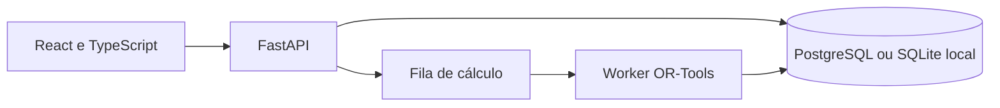

# Chronos — Gestão de Jornadas e Escalas

## 1. Apresentação

Aplicação para organizar pessoas, jornadas, demanda e cenários de escalas com revisão humana.

## 2. Problema empresarial

Planejar cobertura e custos sem perder o vínculo com contratos, competências e regras configuradas.

## 3. Objetivo

Apoiar o planejamento e a revisão de cenários; propostas e hipóteses permanecem rastreáveis.

## 4. Funcionalidades implementadas

- Cadastros de pessoas, unidades, setores, competências e perfis de acesso.
- Calendário, indisponibilidades, jornadas e regras versionadas.
- Cenários e simulação financeira; otimização com OR-Tools em worker separado.
- Propostas e decisões com revisão, auditoria e exportações.
- Central de automações locais; integração n8n opcional, bloqueada pelo status de segurança existente.

As funcionalidades foram identificadas nos módulos e na documentação originais. Os resultados de verificação desta cópia estão em [Validação](docs/github/VALIDACAO.md); não se alegam ganhos de negócio ou métricas de produção.

## 5. Tecnologias

Python 3.13, FastAPI, Pydantic, SQLAlchemy, Alembic, OR-Tools, React, TypeScript, Vite e Tailwind. PostgreSQL é o alvo configurado; SQLite é uma opção explícita para demonstração local.

Os manifests originais foram preservados. Nenhuma dependência nova foi adicionada à aplicação para esta apresentação.

## 6. Arquitetura



[Arquitetura e limites da cópia](docs/github/ARQUITETURA.md).

## 7. Estrutura de pastas

```text
backend/          API, migrations, serviços, scripts e testes
frontend/         interface React/TypeScript e testes
data/synthetic/   dados fictícios reproduzíveis
scripts/          preparação e execução local
desktop/          distribuição Windows
automation/n8n/   contratos e política da integração opcional
docs/             arquitetura, API, regras e documentação
```

Ambientes instalados, caches, bancos operacionais, configurações privadas e compilados ficam fora do pacote fonte. [Critérios de seleção](docs/github/SEGURANCA.md).

## 8. Instalação

Requisitos: Python 3.13, Node.js 22.14+ e npm. Abra PowerShell na raiz desta cópia. O comando instala apenas as dependências declaradas e cria um runtime separado:

```powershell
$env:CHRONOS_RUNTIME_DIR = Join-Path $env:LOCALAPPDATA 'Chronos\github-demo'
.\scripts\setup.ps1
.\scripts\create-admin.ps1
```

## 9. Configuração do ambiente

O setup preserva um .env existente e prepara configuração local quando ausente. Escolha sua própria senha administrativa. O .env.example deixa segredos vazios; nunca comite o .env ou o runtime. SQLite exige CHRONOS_ALLOW_SQLITE e um banco fora do projeto/OneDrive. PostgreSQL requer banco e credencial próprios. Não configure n8n para esta avaliação.

## 10. Como executar

Mantenha CHRONOS_RUNTIME_DIR apontando para o mesmo diretório em cada terminal:

```powershell
.\scripts\start-backend.ps1
```

```powershell
.\scripts\start-frontend.ps1
```

Para cálculos, em outro terminal, execute `.\scripts\start-worker.ps1`. A interface fica em http://127.0.0.1:5187 e a API em http://127.0.0.1:8017/docs. Não inicie n8n ou o consumidor de automações para apenas conhecer a interface.

Os comandos desta documentação se destinam a uma cópia preparada pelo leitor; não foram usados para iniciar a operação do autor nesta etapa.

## 11. Como testar

Com o runtime configurado:

```powershell
.\scripts\check.ps1
```

Esse script confere a fixture, os documentos, testes backend, frontend e build. Para testar somente SQLite, mantenha CHRONOS_TEST_POSTGRES_URL ausente e não reutilize .env de operação. O perfil PostgreSQL, quando usado, deve ser um banco descartável exclusivo de testes.

[Resultados e limitações da verificação desta preparação](docs/github/VALIDACAO.md).

## 12. Capturas e demonstrações reais

[Veja as telas e demonstrações já existentes no portfólio](https://leandroaugferreira.github.io/chronos.html). Não foram criadas imagens fictícias nem alteradas as mídias do projeto.

## 13. Limitações conhecidas

Demonstração 1.0/Fase 10, sem liberação de produção. Não comprova cobertura universal, conformidade jurídica, economia ou produtividade humana. A integração n8n permanece bloqueada pela política existente. PostgreSQL e testes de navegador não foram homologados novamente nesta preparação.

## 14. Estado atual

Código-fonte disponibilizado pelo autor para demonstração e avaliação técnica. As evidências locais de 02/11/2026 estão em docs/github/VALIDACAO.md. Os limites e gates de produção descritos na documentação continuam aplicáveis.

A escolha de licença depende da aprovação do autor; nenhuma licença nova foi atribuída.

[Arquitetura](docs/architecture/architecture.md) · [API](docs/api/api.md) · [Modelo de dados](docs/database/model.md) · [Guia de uso](docs/user-guide.md)

## 15. Portfólio

[Chronos — Gestão de Jornadas e Escalas no portfólio](https://leandroaugferreira.github.io/chronos.html) · [Portfólio completo](https://leandroaugferreira.github.io/).

Repositório: [LeandroAugFerreira/chronos-gestao-escalas](https://github.com/LeandroAugFerreira/chronos-gestao-escalas).
