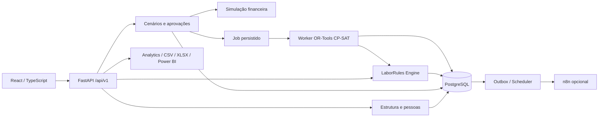

# Chronos 1.0 — Arquitetura inicial

## Decisões

**ADR01 — Monólito modular com worker separado.** Menor custo operacional no Windows; domínios com interfaces explícitas permitem extração futura. FastAPI não executará CP-SAT no event loop. Worker consome jobs persistidos; Redis só será adicionado se carga/concorrência justificarem.

**ADR02 — PostgreSQL como referência.** SQLAlchemy 2 e Alembic na Fase 2. SQLite será um perfil temporário leve com `PRAGMA foreign_keys=ON`, nunca prova de equivalência de RLS, locks, JSONB, tipos temporais ou concorrência. Banco ativo fora do OneDrive. PostgreSQL obrigatório nos testes de persistência e isolamento antes de aceite da Fase 2.

**ADR03 — Configuração multissegmento.** Organization → Unit → Department; funções, competências, habilitações, turnos e demandas são registros com organization_id. O núcleo recebe requisitos e elegibilidade, não condições como `if sector == UTI`. Adaptações hospitalares são dados e políticas versionadas.

**ADR04 — Cenários imutáveis após submissão.** Snapshot de entradas, regras, premissas, versão do algoritmo e hash; ajuste gera versão filha. Aprovação nunca altera a versão aprovada. Atualizar uma regra não recalcula uma escala publicada silenciosamente.

**ADR05 — Frontend por domínio.** React + TS + Vite + Router + TanStack Query. Tailwind e componentes reutilizáveis na Fase 3; React Hook Form/Zod quando existirem formulários de edição; Recharts ou Plotly para gráficos calculados. CSS de tokens no checkpoint define identidade temporal neutra, navy/grafite, ciano, contraste, dark/light. Nenhum ícone/logotipo hospitalar.

**ADR06 — Integrações opcionais.** Funções principais independem de n8n e IA. APScheduler local com uma instância líder, outbox para eventos e entrega pelo menos uma vez com deduplicação. APIs externas de IA são opt-in e não recebem dados pessoais por padrão.

## Componentes e limites

Checkpoint real: UI → `/api/v1/demo/summary` → arquivo sintético. Não existe banco ou worker executável ainda. Demais componentes são especificação.

## Organização

`backend/app/api` transporta contratos HTTP; `core` configuração/segurança; `models` persistência; `schemas` validação; `repositories` acesso a dados; `services` casos de uso; `rules`, `optimization`, `analytics`, `automation`, `workers` são domínios. `backend/alembic` guarda migrations futuras e `tests` verifica comportamento. Frontend separa componentes, layouts, páginas, hooks, serviços, tipos, utils, estilos e assets. Docs cobrem arquitetura, requisitos, banco, API, regras, processos, testes e portfólio. Diretórios reservados contêm apenas `.gitkeep`, sem alegar implementação.

## Segurança e execução

Na Fase 2, JWT de curta validade, refresh rotacionado/invalidável, hash Argon2id, permissionamento por ação, unidade e organização. O tenant vem do principal autenticado; IDs de payload não autorizam acesso. Financeiro recebe custos agregados e o perfil Demo é restrito. Consultas e FKs compostas bloqueiam associação entre tenants; RLS PostgreSQL será uma camada adicional a validar com pooling.

O checkpoint não possui login e contém somente totais sintéticos e nomes de funções/setores, em loopback. Não deve receber dados reais nem ser exposto. CORS usa allowlist. Futuro: rate limiting de login/importação, limite/tipo de uploads, CSV seguro contra fórmulas, correlação, auditoria sem tokens/senhas, retenção por organização, backup/restauração e exclusão controlada.

Datas são instantes aware UTC, com timezone IANA da unidade; intervalos `[início,fim)` evitam dupla contagem. Regra considera dia local e vigências por segmento temporal. Valores monetários em centavos/Decimal; solver em minutos inteiros e custos inteiros escalados. Horas noturnas remuneráveis não são confundidas com tempo real de descanso.

## Ambiente inspecionado

Windows/PowerShell; Python 3.13.0, Node.js 22.14.0, npm 10.9.2 e Git 2.52.0.windows.1. Docker não encontrado. Memória via CIM indisponível no sandbox; não foi estimada. Não houve instalação global. A primeira criação de venv com ensurepip falhou no sandbox; instalação isolada com `venv --without-pip` e `pip --python` contornou a limitação. Downloads precisaram de execução com acesso à rede. Sem PostgreSQL/n8n iniciados nesta fase.

## Referências técnicas consultadas em 24/10/2026

- [FastAPI — primeiros passos](https://fastapi.tiangolo.com/tutorial/first-steps/).
- [Vite — requisitos de execução](https://vite.dev/guide/): Node encontrado atende ao mínimo documentado para a versão utilizada.
- [OR-Tools — CP-SAT](https://developers.google.com/optimization/cp/cp_solver/).
