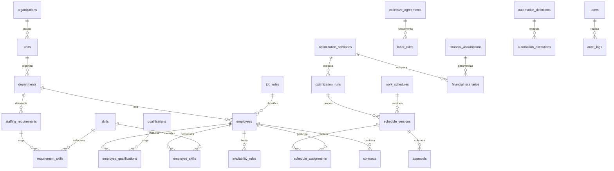

# Chronos 1.0 — Modelo relacional inicial

**Atualização até a Fase 3:** o backend implementa 23 tabelas e cinco migrations. A quinta adiciona revisão aos catálogos. Identidade/RBAC, estrutura/catálogos, pessoas/contratos/disponibilidade e idempotência estão persistidos; escalas, regras, financeiro e automações abaixo permanecem no modelo alvo. Veja `docs/architecture/phase2.md` e `phase3.md`. O texto seguinte documenta o planejamento original, não uma alegação de que todas as entidades já existem.

Modelo projetado, ainda sem migrations ou persistência executáveis. PostgreSQL é o alvo. IDs UUID na persistência; IDs legíveis na fixture serão mapeados pelo importador. `organization_id` é obrigatório em todas as entidades empresariais, inclusive tabelas associativas, parâmetros, jobs, notificações e auditoria. Catálogos de permissões do sistema são globais e imutáveis pelo tenant.

## Dicionário de entidades

Colunas comuns: `id UUID PK`, `organization_id UUID NOT NULL`, `created_at timestamptz`, `updated_at timestamptz` em registros mutáveis. `(organization_id,id)` é unique para permitir FKs compostas. A coluna de versão otimista será usada nas edições concorrentes.

| Entidade | Campos e relacionamentos principais |
|---|---|
| organizations | name, segment, timezone, settings_version, synthetic; raiz tenant |
| units | organization_id, name, timezone, operating_calendar_id |
| departments | unit_id, name, group configurável, cost_center_id, operating_calendar_id |
| cost_centers / teams / team_members | classificação financeira e equipes por unidade; associação de membros com vigência |
| operating_calendars / calendar_windows | fuso, dia da semana, abertura/encerramento, exceções de feriado e dia seguinte |
| job_roles | name, professional_category_id; nenhuma função hospitalar fixa no código |
| skills / qualifications | nome, tipo configurável, exigência de comprovação, categoria/fonte opcional |
| role_skills / role_qualifications | requisitos da função; nível, combinação AND/OR e vigência |
| employees | unit_id, department_id, job_role_id, registration, fictitious_name, status; sem CPF/dados médicos |
| employee_skills | employee_id, skill_id, level, valid_from, valid_until, evidence_ref |
| employee_qualifications | employee_id, qualification_id, verificação, evidência sintética, validade, verified_by |
| contracts | employee_id, vínculo, categoria, work_pattern_id, minutos contratuais, salário em centavos, início/fim, status de validação |
| availability_rules | employee_id, instante inicial/final ou recorrência, available/unavailable, fonte/prioridade; motivo não sensível |
| employee_preferences | folgas, turnos e pesos; preferências nunca suplantam restrições rígidas |
| work_patterns | ciclo parametrizado, minutos, descanso, regras aplicáveis; status não presume legalidade |
| shift_templates / shift_breaks | início/fim locais, offset de dia, intervalos e duração; limite aplicável vem das regras |
| staffing_requirements | department_id, janela, mínimo/ideal, criticidade, versão, fonte e validação; dimensão por atividade |
| requirement_skills / requirement_qualifications | requisitos AND/OR para posto/atividade, validade e nível; impede cobrir duas exigências com uma pessoa indevidamente |
| coverage_substitutions | função/competência de origem e destino, equivalência, justificativa, aprovador e vigência; substituição não é livre |
| work_schedules | unidade, período, referência de versão atual; publicação apenas por caso de uso autorizado |
| schedule_versions | work_schedule_id, parent_id, número, status, hash, snapshot de regras/premissas/entradas, submitted_at; imutável após análise |
| schedule_assignments | schedule_version_id, employee_id, posto/departamento, início/fim, breaks, substitui assignment_id opcional |
| optimization_scenarios | base_version_id, horizonte, modo strict/diagnostic, configuração, created_by, rule_snapshot_hash |
| optimization_runs | scenario_id, seed, solver_version, algorithm_version, job_id, parâmetros, status, objective/bound, duração, diagnóstico e gap |
| financial_assumptions | tipo, valor/unidade, fonte, vigência, aprovador, simulated, versão; sem alíquota universal |
| financial_scenarios | scenario_id, assumption_snapshot, resultado detalhado, moeda, período e divergências |
| collective_agreements | categoria, localidade, arquivo/hash/fonte, início/fim, validation_status |
| labor_rules | key, versão, descrição, fonte/dispositivo, validade, escopo, expressão tipada, severidade, validation_status, responsável |
| rule_evaluations | scenario/version, rule_version_id, funcionário/intervalo, resultado, evidência; snapshots de regra não mudam |
| approvals | schedule_version_id, hash avaliado, solicitante, decisor, data, decisão, justificativa |
| automation_definitions | código A01–A07, trigger, enabled, responsável, próxima execução, configuração versionada |
| automation_executions | definição, event_id, idempotency_key, status, tentativas, tempos, resultado e erro sanitizado |
| jobs / outbox_events | tipo, payload mínimo, tenant, status, lease/heartbeat, retry_at, dedup_key e correlation_id |
| notifications | destinatário, evento, canal interno, status, dedup_key e leitura |
| audit_logs | ator, ação, entidade, versão, diff minimizado, timestamp, correlation_id; append-only |
| users / roles / permissions | principal e papéis Admin/RH/Gestor/Financeiro/Analista/Demo; permissões por ação |
| user_roles / role_permissions | vínculos por tenant e escopo de unidade; não confiar em role enviado pelo cliente |

## Integridade e índices previstos

- FK `(organization_id,unit_id)` → units, `(organization_id,department_id)` → departments, e o mesmo padrão para pessoas/cenários/regras. Evita referências cruzadas mesmo se o código falhar.
- Uniques: matrícula `(organization_id,registration)`, regra `(organization_id,key,version)`, escala `(organization_id,work_schedule_id,version_number)`, execução `(organization_id,idempotency_key)`, vínculo de competência `(organization_id,employee_id,skill_id,valid_from)`.
- Checks: fim > início; minutos/salários não negativos; minimum ≤ ideal quando ideal informado; início de vigência < fim; offset de dia explícito; percentual em intervalo documentado; enum de estados sem transições implícitas.
- Índices: `(organization_id,unit_id,status)`, `(organization_id,department_id,status)`, `(organization_id,employee_id,start_at,end_at)`, `(organization_id,effective_from,effective_until)`, jobs `(status,retry_at)`, outbox `(published_at,created_at)`.
- Impedir sobreposição de alocações por pessoa dentro da mesma versão em PostgreSQL via exclusion constraint de intervalo (btree_gist) ou validação transacional sob lock. Cenários distintos podem conter alternativas sobrepostas.
- Contrato aplicável e qualificação devem cobrir cada intervalo planejado. Sobreposição de contratos incompatíveis impede avaliação; não escolher arbitrariamente.
- Não usar delete cascade em escala aprovada, regra utilizada, decisão ou auditoria. Arquivamento/retention conserva rastreabilidade; exclusão de dados pessoais terá anonimização e escopo documentado.

## Ordem de migrations da Fase 2

1. Tenant, usuários, RBAC e catálogos mínimos.
2. Organização/unidade/setor/função/competência/qualificação e chaves compostas.
3. Pessoas, contratos e disponibilidade; índice e constraints de vigência.
4. Fixture importada transacionalmente com mapeamento de IDs e comando de restauração restrito a demo.

As entidades de escala, regras, financeiro e automação entram em migrations incrementais das fases correspondentes. Cada migration terá upgrade/downgrade testados em PostgreSQL; diferenças SQLite serão registradas. O modelo não equivale a migrations já implementadas.

## Modelo efetivamente implementado na Fase 4

O diagrama acima representa o alvo completo, não a disponibilidade de todos os módulos. A migration 006 acrescenta três tabelas às 23 já implementadas e configuração JSON em work_patterns:

| Tabela | Conteúdo efetivo |
|---|---|
| labor_rules | key/version únicos por organização; kind/minutes/threshold_minutes; escopo unit_id/job_role_id/contract_id/agreement; fonte/vigência; status/review_evidence/reviewer_id; supersedes_id com FK de tenant e sucessora única |
| calendar_shifts | employee_id/unit_id/department_id, início/fim UTC, pausas JSON tipadas, label, state draft/cancelled, revision e última evaluation JSON |
| schedule_evaluations | shift_id/actor_id/shift_revision e snapshot JSON; histórico sem alteração pela API |
| work_patterns.configuration | ciclo work/rest e duração em minutos para novas hipóteses; {} para referências anteriores; não gera plantões nem valida regime |

Regras têm sucessão explícita, sem apagar versões ou alterar avaliações anteriores. Calendário é planejamento manual em rascunho; cenários aprovados, solver e demais tabelas do modelo-alvo continuam nas fases correspondentes. Constraints e upgrade/downgrade foram incluídos nos testes dos dois bancos. Ver docs/architecture/phase4.md.

## Modelo efetivamente implementado na Fase 5

Migration 007 acrescenta duas tabelas às 26 anteriores:

| Tabela | Conteúdo efetivo |
|---|---|
| scenario_versions | unidade/população, actor_id, key/version, parent_id, mês; inputs/capacity/evidence e payroll_snapshot separados; fingerprint HMAC; versão imutável |
| financial_runs | unidade/cenário/autor, nome, assumptions/result JSON e digest; FK composta exige cenário na mesma organização/unidade |

Total no checkpoint da Fase 5: 28 tabelas de domínio e sete migrations, além de alembic_version. A base salarial não é serializada nas rotas de capacidade. Evidências pessoais exigem people:read adicional; resultados financeiros exigem finance:read. Restauração restrita de demo elimina primeiro projeções e cenários. Upgrade/downgrade e integridade são testados nos dois bancos.

## Modelo efetivamente implementado na Fase 6

Migration 008 acrescenta quatro tabelas às 28 anteriores, totalizando 32 tabelas de domínio e oito migrations:

| Tabela | Conteúdo efetivo |
|---|---|
| optimization_runs | Unidade/cenário/autor, inputs/snapshot/HMAC, estados queued/running/succeeded/failed/cancelled, revisão, tentativas, cancelamento, lease/token/heartbeat, resultado e erro seguro |
| schedule_versions | Unidade/run, série/versão/pai, estado draft/submitted/approved/rejected/superseded, revisão, payload imutável, verificação e digest |
| schedule_decisions | Proposta/ator, ação, justificativa, digest de conteúdo e insumos; histórico sem mutação pública |
| entity_reviews | Tipo/id da entidade, unidade/ator, digest revisado, fonte e evidência; não substitui a entidade imutável |

FKs compostas vinculam jobs a cenários e propostas a jobs da mesma organização/unidade. Unicidade impede duas propostas para o mesmo run e versões repetidas na série. Restauração da demonstração exclui primeiro decisões, propostas, jobs e revisões. `Organization.fixture_hash = fixture_hash` serve como lock transacional de organização para coordenar alterações de negócio com a aprovação; o valor da fixture é preservado.

## Modelo efetivamente implementado na Fase 7

Migration 009 acrescenta nove tabelas às 32 anteriores, totalizando 41 tabelas de domínio e nove migrations:

| Tabela | Conteúdo efetivo |
|---|---|
| automation_definitions | Unidade/código A01–A07, enabled false, responsável, intervalo/próxima/última execução, parâmetros e revisão |
| outbox_events | Referência de negócio, unidade/ator/correlação, fonte/códigos, dedupe_key, estado, lease, tentativas/limite, backoff, erro e resultado |
| automation_executions | Definição/evento/ator, rotina/fonte, tentativa, início/fim, estado, resultado e erro seguro; unicidade por definição/evento/tentativa |
| automation_notices | Aviso por unidade/recurso/destinatário, chave única, severidade, corpo, referência e ciência; FKs de destinatário e ciência com nomes distintos para PostgreSQL |
| automation_artifacts | CSV congelado por definição/evento: nome, MIME, conteúdo, digest e marca de restrição financeira |
| automation_suggestions | Evento/proposta/run de origem, motivo, quantidade de alocações afetadas e estado; não modifica a proposta |
| integration_credentials | Unidade/ator, nome, ações, SHA-256 do token opaco, habilitação e revisão; sem token recuperável |
| integration_receipts | Unidade/credencial/request_id, HMAC do conteúdo, ação e resultado confirmado; unicidade para replay |
| webhook_deliveries | Definição/evento/unidade/código, estado, lease/tentativas/backoff, último status HTTP e erro; unicidade por definição/evento |

Não são criados defaults de habilitação ou segredo. Seed idempotente acrescenta as sete definições desativadas por unidade, sem reimportar pessoas. A restauração remove recibos/entregas/credenciais e efeitos de automação antes de eventos, definições e tabelas de cenário. Os leases usam token de posse, e retentativa manual mantém a sequência de tentativas. O banco n8n é separado, opcional e fica fora do projeto/OneDrive.

## Atualização da Fase 9

A migration 010_pattern_revision adiciona work_patterns.revision inteiro não nulo com default 1. Mantém as 41 tabelas e o incremento já usado pela revisão de jornadas; digests incluem a revisão persistente. Nenhuma validação jurídica ou atualização de salários é aplicada pela migration. O ready exige head 010. Backup/restauração de cópia e comparação de hashes de todas as colunas anteriores do banco local foram feitos antes/depois da atualização. [Evidências](../testing/phase9-report.md).
