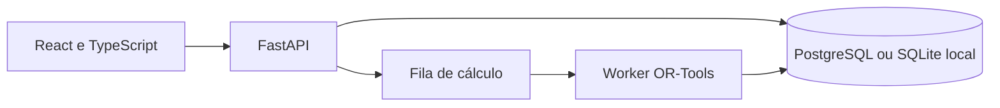

# Arquitetura observada

Python 3.13, FastAPI, Pydantic, SQLAlchemy, Alembic, OR-Tools, React, TypeScript, Vite e Tailwind. PostgreSQL é o alvo configurado; SQLite é uma opção explícita para demonstração local.

Demonstração 1.0/Fase 10, sem liberação de produção. Não comprova cobertura universal, conformidade jurídica, economia ou produtividade humana. A integração n8n permanece bloqueada pela política existente. PostgreSQL e testes de navegador não foram homologados novamente nesta preparação.

O diagrama resume relações encontradas no código; não representa uma implantação em produção. Serviços externos opcionais não foram ativados nesta preparação.
